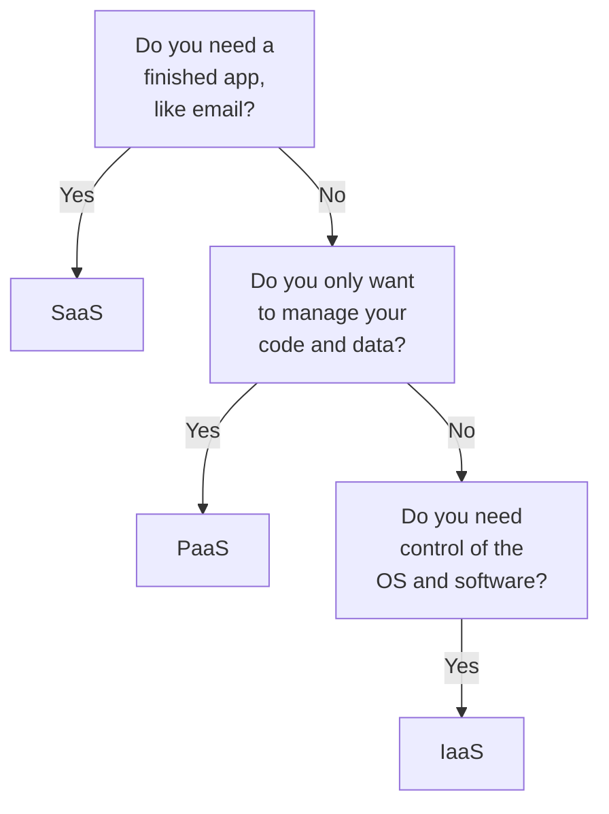

# Domain 1 — Describe cloud concepts

Describe cloud concepts is published at 25–30% of the exam, the smallest of the three areas. It
rewards one skill above all: knowing exactly what each cloud word means and which neighbouring word
it is not. Hybrid and multicloud, scalability and elasticity, vertical and horizontal scaling, PaaS
and SaaS: many questions turn on the boundary between them rather than on the definitions alone.

We suggest studying it first, because the other two areas assume this vocabulary on every page.

| Exam objective | Where it is taught |
|---|---|
| Describe cloud computing | What cloud computing is; shared responsibility; cloud models; paying for it; serverless |
| Describe the benefits of using cloud services | Staying up and keeping up; security, governance and manageability |
| Describe cloud service types | IaaS, PaaS and SaaS |

The definitions and examples on this page are Microsoft's own, from its exam training and Azure
documentation. The columns headed "the separator" and the decision ladder are our exam guidance.

---

## What this domain actually asks

Three habits carry most of the marks here.

**Know who is responsible for what.** The shared responsibility model comes back in questions far
beyond its own bullet. You always own your data, your accounts and access, and protecting the devices that connect
(in SaaS some device management can be shared). The
provider always owns the physical datacenter, network and hosts. Everything in between moves with
the service type, and IaaS leaves the most of it with you.

**Tell the neighbours apart.** Most wrong answers in this domain are real words from the same
family. Hybrid cloud is public plus private; multicloud is several public providers. Adding processor or memory to
one virtual machine is vertical scaling; adding virtual machines is horizontal. Paying as you
consume makes cloud spending operational expenditure, not capital.

**Read for the deciding phrase.** Microsoft does not capitalise words like *most* or *not*. The
phrase that decides the answer sits in ordinary text: "the most control", "without managing the
underlying infrastructure", "temporary demand". Find it before you look at the options.

---

## What cloud computing is, and what it changes

Microsoft's definition is short: **cloud computing is the delivery of computing services over the
internet**. Those services include the common information technology (IT) infrastructure of virtual machines, storage,
databases and networking. They also extend to things a traditional datacenter rarely offered, such
as Internet of Things (IoT), machine learning (ML) and artificial intelligence (AI).

Watch for distractors that shrink the definition to one service. "Delivery of storage over the
internet" and "websites you can reach online" are both true of the cloud, but neither is the
definition.

Two things change straight away. The first is **speed**. Because the cloud is delivered over the
internet, it is not limited by physical infrastructure the way your own datacenter is. If you need
more capacity quickly, you do not wait for a new building. Most cloud services are self-service and
on demand, so even large amounts of computing can be provisioned in minutes. That takes the
pressure off capacity planning.

The second is **reach**. Cloud platforms offer global reach, so you can place services closer to
your users and design for regional resilience without building datacenters in each place. Both of
these come back as named benefits later in the domain: speed as agility, and reach as
geo-distribution.

---

## Shared responsibility: who does what

**Some responsibilities never move, some always move, and the rest depend on the service type.**
That is the whole model, and it is worth learning as three lists rather than as one diagram.

In a traditional on-premises datacenter you are responsible for everything: the building, its
security, the servers, and keeping every system patched. Move to the cloud and the work is shared.
The provider takes physical security, power, cooling and network connectivity. You are not in the
building, so it would make no sense for you to hold any of that.

What stays with you, whatever the service type:

- the information and data stored in the cloud
- protecting the devices allowed to connect to it, such as phones and laptops
- the accounts and identities of the people, services and devices in your environment
- managing access to it

What always sits with the provider: the physical datacenter, the physical network and the physical
hosts. Microsoft also runs the hypervisor that virtual machines sit on.

Everything else depends on the model you choose, mainly operating systems, network controls and
applications. Client devices shift slightly too: in SaaS, Microsoft can provide some device
management capabilities, so the matrix marks devices as shared, but endpoint protection and
compliance stay yours.

| Layer | IaaS | PaaS | SaaS |
|---|---|---|---|
| Data, identities and access | You | You | You |
| Client devices | You | You | Shared |
| Applications | You | Shared | Shared |
| Network controls | You | Shared | Provider |
| Operating system | You | Provider | Provider |
| Physical hosts, network and datacenter | Provider | Provider | Provider |

**IaaS places the most responsibility on you; SaaS places the most on the provider; PaaS sits in the
middle.** The practice assessment asks this in both directions: which model gives you the most
control, and which leaves you responsible for the operating system. The answer to both is IaaS.

The clearest illustration is one database engine run two ways. With a managed cloud SQL database
service, the provider maintains the database itself and you remain responsible for the data you put in it.
Install SQL Server on a virtual machine yourself, and you are responsible for the database's patches
and updates as well as the data. Same engine, two different splits.

One point needs care. Microsoft's training describes identity and access as shared in PaaS and
SaaS: you manage your users, roles and policies while the provider runs the sign-in platform, such
as Microsoft Entra ID. Microsoft's security documentation puts it from the other side: you own
your identities in every deployment type. Both agree on what matters for the exam. **Managing who
has access is always your job.** No option that hands it to the provider is correct.

> **Trap.** "Once data is in the cloud, the provider is responsible for securing it." Never. Data is
> on the always-yours list in IaaS, PaaS and SaaS alike. The provider secures the building, the
> network and the hosts.

<b>Self-check — shared responsibility</b>

1. Name the responsibilities you keep in every cloud service type.
2. A team installs SQL Server on an Azure virtual machine. Who patches the database software, and
   how would that change with a cloud SQL database service?
3. In which service type are network controls fully the provider's?
4. Which model places the most responsibility on the customer, and which the least?

**Answers.** (1) Your data, the devices that connect, your accounts and identities, and access
management. (2) The team does, because they installed it on IaaS; with a cloud SQL database the
provider maintains the database and the team still owns the data. (3) SaaS. (4) IaaS places the
most; SaaS the least.

---

## Cloud models: public, private and hybrid

Cloud models describe how cloud resources are deployed. Microsoft names three main ones: private,
public and hybrid.

A **private cloud** is used by a single entity, and its resources are dedicated to that one
organisation. Where it sits does not define it: a private cloud may run in your own datacenter, or
in a dedicated datacenter offsite, even one run by a third party. It gives your IT team much greater
control, but costs more and gives up many of the benefits of public cloud.

A **public cloud** is built, controlled and maintained by a third-party provider, and anyone who
wants to buy cloud services can use it. That general availability is the difference that defines
it. Customers share the underlying infrastructure, but each customer's data and applications stay
isolated. Shared infrastructure is not shared data.

A **hybrid cloud** uses both public and private clouds in one interconnected environment. You choose
which services stay in the public cloud and which run on your private infrastructure.

Microsoft's own comparison is worth knowing almost word for word, because the practice assessment
builds questions straight from it.

| Model | What it gives you | What it costs you |
|---|---|---|
| Public cloud | No capital expenditure to scale up; quick provisioning and deprovisioning; pay only for what you use | You do not have complete control over resources and security |
| Private cloud | Complete control over resources and security; data not collocated with other tenants | Hardware to purchase for startup and maintenance; you maintain and update it |
| Hybrid cloud | The most flexibility; you decide where each application runs and control security, compliance and legal requirements | Two environments to run together |
| Multicloud | Features from more than one public provider | Resources and security to manage in each provider |

**Multicloud is the neighbour that catches people.** In a multicloud scenario you use two or more
*public* cloud providers, perhaps for different features or part-way through moving from one to
another. Hybrid means a public cloud joined to a private cloud or on-premises environment. If no
private cloud is involved, it is not hybrid.

The use cases follow from what each model gives you:

- **Public cloud** suits website and application hosting, and data storage and backup, where you
  want quick provisioning and no hardware to buy.
- **Private cloud** suits organisations that need dedicated resources and more control; Microsoft
  notes it supports security and compliance needs for regulated industries. Regulation alone does
  not force a private cloud: a regulated workload can run in the public cloud when the services and
  the design meet the requirement. Dedication is what makes a cloud private.
- **Hybrid cloud** suits three situations Microsoft names. *Cloud bursting*: when demand exceeds
  private cloud capacity, the hybrid environment taps public cloud resources for the temporary
  peak. *Data residency*: sensitive data stays in the private cloud while everyday applications run
  in the public one. *Modernisation*: legacy applications keep running privately while new
  cloud-native applications are built in the public cloud.

Managing several environments at once has its own tool, Azure Arc, which works across public,
private, hybrid and multicloud environments. You meet it properly in the management domain.

> **Trap.** "A private cloud must be in our own building." Hosting location never decides it. A
> cloud dedicated to one organisation is private even when a third party hosts it.

<b>Self-check — cloud models</b>

1. A company's private cloud cannot cope with a seasonal spike that lasts three weeks. Which cloud
   model handles this without buying hardware, and what is the pattern called?
2. A company uses services from two different public cloud providers and has no private cloud.
   Which model is that?
3. Name two characteristics of a private cloud from Microsoft's comparison.
4. Why is "customers share the same infrastructure" not a reason to think public cloud tenants can
   see each other's data?

**Answers.** (1) Hybrid cloud, using public resources for the temporary demand: cloud bursting.
(2) Multicloud. (3) Any two of: complete control over resources and security, data not collocated
with other tenants, hardware you must purchase, hardware you maintain. (4) Each customer's data and
applications remain isolated on the shared infrastructure.

---

## Paying for it: the consumption-based model and pricing models

**In Microsoft's words, you pay for the IT resources you use, and nothing more.** That is the
consumption-based model, and it describes pay-as-you-go. Instead of buying and maintaining your own datacenter, you rent compute and
storage and release it when you are done. Cloud providers use a pay-as-you-go pricing model:
you typically pay only for the services you consume, which helps you plan operating costs, run infrastructure more efficiently and scale as needs change.

It helps to see the problem it solves. With a traditional datacenter you estimate future demand in
advance. Overestimate and you pay for hardware that sits idle. Underestimate and your applications
slow down until new hardware is ordered, installed and powered. In the cloud you add resources when
demand rises and release them when it falls, so there is no hardware to buy up front that might sit
idle. Resources you leave running still cost money until you release them.

The accounting words come up often. **Capital expenditure (CapEx)** is up-front spending on physical
infrastructure: servers, network hardware, datacenter space. **Operational expenditure (OpEx)** is
ongoing spending on services over time. Because you pay for cloud services as you consume them,
**cloud computing is classified as an operational expense.** That is the distinction the exam
tests: in an exam question, an option calling cloud spending CapEx is the wrong one. It is the exam's model,
not an accounting rule for every cloud contract.

Pay-as-you-go is the default, not the only choice. The guide asks you to compare pricing models,
and Azure offers several.

| Pricing model | How it works | Suits |
|---|---|---|
| Pay-as-you-go | Standard rates for what you use; no commitment | Variable or short-lived usage |
| Azure Reservations | Commit to one or three years for a discount on a specific resource, size and region | Consistent, steady usage |
| Azure savings plan | Commit to an hourly spend for one or three years; discount applies across eligible services and regions | Usage that changes shape over time |
| Azure Spot Virtual Machines | Unused Azure capacity at a significant saving; evicted whenever Azure needs it back; no SLA | Work that can be interrupted |

The separator between the two commitments is flexibility. A reservation is a billing discount
locked to a specific resource, size and region; it applies automatically to matching resources and
pays off when that usage is steady. It is not tied to one named machine: a VM reservation optimised
for instance size flexibility can also cover other sizes in the same group. A savings plan commits a spend rather
than a resource, so it follows your usage as it changes. Spot is the opposite end: no commitment,
deep savings, and no guarantee the machine stays.

A commitment is where "pay only for what you use" stops being literally true. Microsoft says unused
savings plan commitment for an hour expires and does not roll over: you trade some flexibility for
the discount.

One more name sounds like a pricing model and is not one. **Azure Hybrid Benefit** is a licensing
benefit: you bring eligible licences you already own, such as SQL Server licences with Software
Assurance, and pay less on Azure. It has nothing to do with the hybrid cloud model.

> **Trap.** "Spot VMs are a cheap way to run a production system that must stay up." Spot capacity
> can be taken back at any time and carries no SLA. Cheap and interruptible go together.

<b>Self-check — paying for it</b>

1. Why is cloud computing classified as an operational expense?
2. What two things go wrong when you estimate capacity for a traditional datacenter?
3. A workload runs the same virtual machine size in one region all day, every day, for the next
   three years. Which pricing option fits, and why not a savings plan?
4. What does Azure Hybrid Benefit actually give you?

**Answers.** (1) You pay for services as you consume them, rather than spending up front on
physical infrastructure. (2) Overestimate and you pay for idle hardware; underestimate and
performance suffers. (3) A reservation: steady use of a specific resource, size and region is
exactly what it discounts (a VM reservation optimised for size flexibility can also cover other
sizes in its group). A savings plan also works, but its strength is flexibility you do not
need here. (4) The use of eligible licences you already own, for a lower price on Azure.

---

## Serverless

**Serverless does not mean there are no servers. It means you do not manage them.** Serverless
computing is a cloud execution model in which the provider handles the infrastructure, scaling and
maintenance, and you write and deploy code. The servers still run your code; provisioning and
managing them is simply invisible to you.

Three properties come with it, and the exam can ask about any of them:

- **Event-driven.** Code runs in response to events, such as a request, a message or a schedule,
  and only when triggered.
- **Pay per execution.** You pay for the number of executions and the compute time consumed, not
  for server capacity you set aside in advance.
- **Automatic scaling.** The platform adjusts up and down automatically to match demand, so there
  is no capacity to plan. How fast, and how far, depends on the service and its hosting plan.

Common uses are event-driven applications, real-time data processing, back ends for web and mobile
apps, and scheduled tasks. The Azure example is **Azure Functions**, Microsoft's serverless
solution: instead of deploying and maintaining servers, you rely on the cloud infrastructure, and
event-driven triggers connect your functions to other services without extra code.

Do not confuse serverless with the consumption-based model. Every cloud service is
consumption-based in the broad sense. Serverless goes further: no servers to manage at all, and
billing per run.

---

## Benefits: staying up and keeping up

**High availability** means keeping resources available when needed, regardless of disruptions.
Azure gives uptime guarantees that depend on the service, and those guarantees are written into
each service's **service-level agreement (SLA)**. Some offerings, such as Spot VMs, have no SLA at
all.

An SLA documents the commitment and its conditions; it does not build availability for you.
Microsoft's practice assessment still keys "the SLA" for "what is high availability in a public
cloud dependent on?", so read that question as asking where the guarantee is written. Microsoft's reliability
guidance splits the work: Microsoft is responsible for core platform reliability and for providing
capabilities such as availability zones and multiple regions, and you are responsible for selecting
and using the ones your workload needs, and for meeting the conditions the SLA sets.

**Scalability** is the ability to adjust resources to meet demand. It works in both directions:
when demand drops you reduce resources, and because the cloud is consumption-based, your costs fall
with them. It comes in two kinds, and so does the vocabulary.

| Term | What changes | Confused with | The separator |
|---|---|---|---|
| Vertical scaling | The capability of a resource: adding or removing processor (CPU) or random access memory (RAM) on one virtual machine | Horizontal scaling | Scale up and down |
| Horizontal scaling | The number of resources: more or fewer virtual machines or containers | Vertical scaling | Scale out and in |
| Scalability | Capacity: the ability to adjust resources to demand | Elasticity | Can capacity be adjusted to meet demand |
| Elasticity | Automation and speed: resources adjusting automatically, in real time | Scalability | Does it adjust by itself |

So "adding virtual machines to handle more users" is horizontal scaling, and "automatically scaling
an application so it has the resources customers demand" is elasticity.

**Reliability** is the ability of a system to recover from failures and keep working. It is one of
the pillars of the Microsoft Azure Well-Architected Framework. The cloud supports it through its
decentralised design: you can deploy resources in regions around the world, so even if one region
suffers a catastrophic event, resources in the other regions keep running. In some cases the cloud environment shifts to
another region for you with no action on your part. "In some cases" matters: otherwise you design
your applications to use more than one region.

**Predictability** comes in two kinds. *Performance predictability* is predicting the resources
needed to give customers a good experience; autoscaling, load balancing and high availability
support it. *Cost predictability* is forecasting spend: tracking use in real time, monitoring
efficiency, finding patterns with analytics, and estimating costs with tools such as the Azure
Pricing Calculator. The Well-Architected Framework shapes both.

The practice assessment also uses a few words that the guide does not list as bullets. Know them
by what they describe.

| Word | What it describes | The tell in a question |
|---|---|---|
| Agility | Deploying new applications and services quickly | Minutes instead of weeks |
| Geo-distribution | Running services in datacenters close to users around the world | Regional datacenters, nearby users |
| Disaster recovery | Backup, replication and redundant sites that keep data safe through a disaster | Cloud-based backup, data replication |
| High availability | Staying available through failures; each service's uptime commitment is in its SLA | Distributing across regions, uptime |

> **Trap.** "High availability comes from moving the app to a bigger virtual machine." That is
> vertical scaling, and it adds capacity to one resource. Availability comes from surviving
> failures, which a single machine cannot do.

<b>Self-check — staying up and keeping up</b>

1. A team adds four virtual machines behind an application during a sales event. What kind of
   scaling is that, and what are the two words for doing it and undoing it?
2. What separates elasticity from scalability?
3. What does a service's uptime guarantee live in?
4. Load balancing supports which kind of predictability?
5. A question lists cloud-based backup, data replication and geo-distribution. What are these
   features of?

**Answers.** (1) Horizontal scaling: scale out, then scale in. (2) Elasticity is the automatic,
real-time adjustment; scalability is the ability to adjust at all. (3) The service-level agreement
(SLA). (4) Performance predictability. (5) A disaster recovery plan.

---

## Benefits: security, governance and manageability

**Cloud features support governance rather than replacing it.** Templates make sure deployed
resources meet your technical standards and regulatory requirements, and when standards change you
can update resources at scale. Cloud-based auditing flags resources that drift out of compliance
with your baseline and suggests how to fix them. Depending on your operating model, patches and
updates can be applied automatically, which helps both governance and security.

Security follows the service type. If you want **maximum control of security**, IaaS gives you the
infrastructure and leaves the operating system and installed software, including patching, to you.
If you want **patches handled for you**, PaaS or SaaS is the better fit. Providers are also
typically well suited to handle distributed denial-of-service (DDoS) attacks, which makes your
network more robust.

**Manageability** has two halves, and the exam likes to swap them.

| Term | What it covers | The separator |
|---|---|---|
| Management of the cloud | What happens to your resources: automatic scaling, deploying from templates, monitoring health and replacing failing resources, alerts on metrics | Done to resources |
| Management in the cloud | How you manage them: a web portal, a command line interface, APIs, PowerShell | Tools you use |

---

## Cloud service types: IaaS, PaaS and SaaS

**The three service types differ in how much of the stack you run.** You met them through shared
responsibility. Here is what each one is for.

**Infrastructure as a service (IaaS)** is the most flexible category and gives you the most
control. The provider maintains the hardware, the network connection to the internet and physical
security. You are responsible for everything else: installing, configuring and maintaining the
operating system, network configuration, and database and storage configuration. You are
essentially renting hardware in a cloud datacenter. Microsoft's example is **Azure Virtual
Machines**.

**Platform as a service (PaaS)** sits in the middle. The provider also runs the operating systems,
middleware, development tools and analytics services, so you do not license or patch operating
systems and databases. You focus on your application code, your data and your access controls.

**Software as a service (SaaS)** is the most complete model from a product point of view: you use a
finished application. Email, messaging, productivity applications and finance software are the
usual examples, and Microsoft 365 is the one the practice assessment uses. SaaS may be the least
flexible model, but it is the easiest to start with and needs the least technical knowledge. You
still manage your data, identity and access settings, and the devices you allow in.

| Type | You manage | Typical use | Confused with |
|---|---|---|---|
| IaaS | Operating system and everything above it | Lift-and-shift migration; test and development | PaaS |
| PaaS | Your code, data and access | Development frameworks; analytics and business intelligence | IaaS, SaaS |
| SaaS | Your data, identities and access, devices | Email, productivity, finance tools | PaaS |

The use cases are where questions live:

- **Lift-and-shift migration** is IaaS: you set up cloud resources that resemble your on-premises
  datacenter and move the workloads across. Microsoft calls it the fastest and least expensive way
  to migrate a workload.
- **Test and development** is IaaS when you need to copy configurations and start or stop whole
  environments quickly while keeping full control.
- **A development framework** is PaaS: developers build on platform components, with scalability,
  high availability and multitenancy already included, so they write less code.
- **Analytics or business intelligence** tools offered as a service are PaaS.
- **Email, messaging and productivity** are SaaS.

When a stem gives you a requirement rather than a definition, walk it from the most managed option
down.

> **Trap.** "Lift-and-shift is PaaS, because the provider runs the platform." Lift-and-shift moves
> workloads onto infrastructure that looks like your own datacenter. You still run the operating
> system, so it is IaaS.

<b>Self-check — service types</b>

1. Which service type gives the most control, and which is the easiest to get running?
2. In which type do you stop worrying about licensing and patching operating systems and databases?
3. A company wants to move its existing servers to the cloud as quickly and cheaply as possible,
   without redesigning them. Which type, and what is the scenario called?
4. Which service model does Microsoft 365 use?
5. Is Azure Virtual Machines IaaS or PaaS, and what makes it so?

**Answers.** (1) IaaS gives the most control; SaaS is the easiest. (2) PaaS. (3) IaaS:
lift-and-shift migration. (4) SaaS. (5) IaaS, because you manage the operating system and
everything above it.

---

## Traps worth carrying into the exam

- **Data, identities, access and protecting your devices are always yours.** In every service
  type; in SaaS some device management can be shared. The provider
  always owns the datacenter, physical network and hosts.
- **IaaS leaves you the most; SaaS the least.** "Most control" and "responsible for the operating
  system" both point to IaaS.
- **Private is about who uses it, not where it sits.** A third party can host a private cloud.
- **Hybrid is public plus private.** Several public providers is multicloud.
- **Cloud spending is OpEx in the exam's model.** You pay as you consume; CapEx is up-front hardware.
- **Reservations fit steady use; savings plans fit changing use; Spot can be evicted and has no
  SLA.** Azure Hybrid Benefit is about licences, not hybrid cloud.
- **Serverless still runs on servers.** You just do not manage them. Billing follows the service and
  hosting plan; the usual consumption pattern is executions and compute time.
- **Adding machines is horizontal; adding CPU or RAM is vertical.** Out and in against up and down.
- **Elasticity is automatic scaling.** Scalability is the ability to scale at all.
- **The SLA states the uptime commitment; your design reaches it** by surviving failures, not by a
  bigger machine.
- **Management of the cloud is what happens to resources; management in the cloud is the tools.**
- **Lift-and-shift is IaaS; a development framework is PaaS; email is SaaS.**
