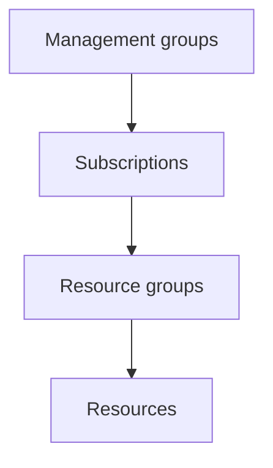
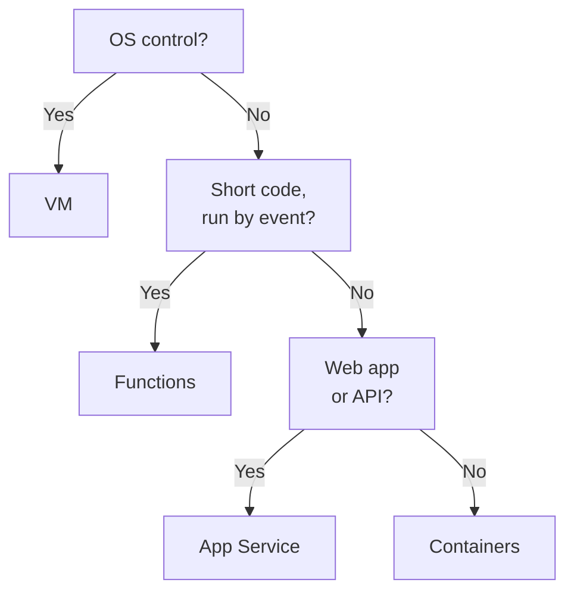

# Domain 2 — Describe Azure architecture and services

Describe Azure architecture and services is published at 35–40% of the exam, the largest of the
three areas. It is where most of the service names live: regions and zones, the management
hierarchy, compute, networking, storage, identity and security. The exam rarely asks what a
service is in the abstract. It asks which of two neighbouring services meets a stated need.

Read it after Domain 1. Shared responsibility and IaaS, PaaS and SaaS come back on almost every page.

| Exam objective | Where it is taught |
|---|---|
| Describe the core architectural components of Azure | Where Azure runs; how Azure is organised |
| Describe Azure compute and networking services | Virtual machines; choosing where code runs; virtual networks; connecting on-premises networks |
| Describe Azure storage services | Storage accounts, services and tiers; redundancy; moving files and migrating |
| Describe Azure identity, access, and security | Identity; access and security |

The definitions and examples on this page are Microsoft's own, from its exam training and Azure
documentation. The columns headed "the separator", and the decision ladder, are our exam guidance.

---

## What this domain actually asks

Three habits carry most of the marks here.

**Know the containers and the boundaries.** A region holds datacenters; a zone-enabled region holds
at least three availability zones. A resource belongs to exactly one resource group, resource
groups sit in a subscription, and subscriptions sit in management groups. Each level has a job, and
questions name the job.

**Pick the neighbour that meets the stated constraint.** VPN Gateway and ExpressRoute both connect
your network to Azure, but only one avoids the internet. LRS and ZRS both keep several copies in the
primary region, but only one survives a datacenter loss. SSO and Conditional Access both happen at sign-in, but only one
decides whether you get in.

**Read for the deciding phrase.** "Without deploying domain controllers", "rarely accessed",
"from a mobile phone", "without managing virtual machines". Microsoft puts the decision in plain
words. Find it before you look at the options.

---

## Where Azure runs: regions, availability zones, region pairs and sovereign regions

**Azure's physical infrastructure starts with datacenters, but you never pick one.** Datacenters
are facilities with racks of servers and their own power, cooling and networking. Azure groups Azure datacenters
into Azure regions and availability zones, and those are what you choose.

A **region** is a geographical area containing at least one, and often several, nearby datacenters
joined by a low-latency network. You usually pick a region when you deploy a resource. Not every
service or virtual machine size is offered in every region. A few global services, such as
Microsoft Entra ID and Azure DNS, need no region at all.

**Availability zones** are physically separate datacenters within a region, each with independent
power, cooling and networking. A zone is an isolation boundary: if one goes down, the others keep
working. Your workload keeps running only if you deployed it across zones. Zone-enabled regions have at least three zones, but **not every region supports
availability zones**. Spreading copies across zones replaces buying duplicate hardware, though
duplicating services and moving data between zones can cost money.

Services relate to zones in three ways. *Zonal* services, such as a virtual machine, are pinned to
one zone that you choose. *Zone-redundant* services, such as zone-redundant storage, are replicated
across zones by the platform. *Non-regional* services are available from Azure geographies rather than pinned to a region you
choose; how each one behaves in an outage depends on the service.

A large enough event can affect several zones in one region. **Region pairs** help with that case.
Most regions are paired with another region in the same geography, so resources can be replicated
far enough away to survive a regional disaster, if you design for it: Microsoft says deploying to a
region in a pair doesn't automatically make resources more resilient or give you failover. Pairs
bring three more things: one region of each
pair is prioritised for recovery in a wide outage, Azure strives to stagger planned updates so the
two regions are not updated together, and data stays in the same geography. Almost every pair is in
one geography; the training names Brazil South as the exception.

Two qualifiers matter. **Not every region has a pair**: some newer regions rely on availability
zones and geo-redundant storage instead. And **not every service fails over by itself**: for many,
you configure replication and recovery yourself.

**Sovereign regions** are instances of Azure isolated from the main instance, used for compliance
or legal reasons. The United States (US) government regions are physically and logically network-isolated and run
by screened U.S. personnel. The China regions are offered through a partnership with 21Vianet, and
Microsoft does not maintain those datacenters directly.

| Unit | What it is | Protects against | The separator |
|---|---|---|---|
| Region | A geographical area with one or more datacenters | Distance from users; local rules | Where you deploy |
| Availability zone | A physically separate datacenter group inside a region | One datacenter failing | Inside one region |
| Region pair | Two regions in one geography | A whole-region disaster, if you replicate across the pair | Across regions |
| Sovereign region | An isolated instance of Azure | Compliance and legal requirements | Separate from main Azure |

<b>Self-check — where Azure runs</b>

1. What separates an availability zone from a region?
2. Does every Azure region have availability zones? Does every region have a pair?
3. Name two things region pairs give you besides a second copy of data.
4. Why might an organisation need a sovereign region?

**Answers.** (1) A zone is a physically separate datacenter group inside a region; the region is the
geographical area. (2) No to both: not every region supports zones, and some regions have no pair.
(3) Any two of: one region in each pair is prioritised for recovery, Azure strives to update one
region of the pair at a time, data stays in the same geography. (4) For compliance or legal purposes, because a sovereign
region is isolated from the main instance of Azure.

---

## How Azure is organised: resources, resource groups, subscriptions and management groups

**The management hierarchy has four levels, and settings flow down it.** A **resource** is anything
you create: a virtual machine, a virtual network, a database. Every resource belongs to exactly
one **resource group** at a time. Resource groups belong to a **subscription**. Subscriptions can be
organised into **management groups**, and all of them fold up into one Tenant Root Group.

A resource group is a lifecycle container. Anything you do to it applies to everything in it:
deleting the group deletes its resources, and access granted on the group applies to all of them.
That is why a temporary test environment usually lives in one group. Resource groups **cannot be
nested** and cannot be renamed after creation.

A subscription is a unit of management, billing and scale, and you need one to use Azure at all.
It is linked to an account, which is an identity in Microsoft Entra ID, and one account can hold
several subscriptions. Each subscription is a **billing boundary** and an **access control boundary**. Microsoft's training
pictures the billing side as separate billing reports and invoices for each subscription; how
charges are grouped on invoices also depends on your billing account. That is why teams often separate development, testing and production
into different subscriptions.

Management groups sit above subscriptions. A policy or role assignment applied to a management
group is inherited by every subscription, resource group and resource below it, and subscription
owners cannot override that policy. Management groups **can be nested**, and every management group
and subscription has exactly one parent.

| Level | Holds | Used for | The separator |
|---|---|---|---|
| Management group | Subscriptions and other management groups | Policy and access across many subscriptions | Can nest |
| Subscription | Resource groups | Billing and access boundary | Separate billing reports |
| Resource group | Resources | Managing resources with one lifecycle | Cannot nest |
| Resource | Nothing | The service you deploy | In exactly one group |

---

## Virtual machines and the options around them

**Azure Virtual Machines is IaaS: you get a server without the hardware, and you keep the
operating system.** You control the operating system and installed software, and you still patch,
update and configure inside the machine. Virtual machines (VMs) fit when you need total control of
the operating system, custom software or a custom hosting configuration. Common uses are testing
and development, application hosting, extending a datacenter, disaster recovery and lift-and-shift
migration.

To create one you choose its **size** (processor cores and memory), its **storage disks**, and its
**networking**: a virtual network, a public IP address if needed, and ports. Sizes are grouped into
families by workload. You can start quickly from an image, a template that already contains an
operating system and tools.

Single machines suit small jobs. Groups of machines bring two features that sound alike:

- **Azure Virtual Machine Scale Sets** manage a group of identical, load-balanced VMs from one
  configuration, and scale out or in automatically on demand or a schedule.
- **Availability sets** spread VMs across **update domains**, which reboot together during planned
  maintenance, and **fault domains**, which share a power or network failure point. They make it
  less likely that one event takes down every VM. They add no cost, but they do not match the
  resiliency of availability zones, which are often preferred where a region has them.

**Azure Virtual Desktop** is a different job: desktop and application virtualisation. Users reach
Windows desktops and apps from many devices, while the desktops stay in Azure. Apps and data can
remain in Azure-hosted sessions instead of on local devices, which helps reduce exposure.

| Option | What it does | Confused with | The separator |
|---|---|---|---|
| Virtual machine | One server you fully control | Containers | You manage the operating system |
| Virtual Machine Scale Sets | Identical VMs that scale automatically | Availability sets | Scaling |
| Availability set | VMs spread over fault and update domains | Availability zones | Resiliency inside a region |
| Azure Virtual Desktop | Windows desktops and apps delivered from Azure | Virtual machines | Desktops for users |

---

## Containers, functions and App Service: choosing where code runs

**The compute types differ in what you manage.** With a virtual machine you manage the operating
system and get maximum control. With a **container** you do not manage the operating system.
Containers are lightweight, many can run on one host, and they start, scale out and stop quickly,
and restart quickly after a crash.
Docker is the best-known container engine, and Azure supports it.

Azure offers containers at several levels:

- **Azure Container Instances** is the fastest and simplest way to run a container, with no virtual
  machines to manage. It is PaaS.
- **Azure Container Apps** is similar, with load balancing and scaling built in.
- **Azure Kubernetes Service (AKS)** orchestrates containers: it manages their lifecycle when you run
  a whole fleet of them.

Containers suit microservice architectures, where a solution splits into small pieces, such as a
front end and a back end, that you scale and update independently.

**Azure Functions** is event-driven, serverless compute with no virtual machines or containers to
maintain. An event wakes the function, it runs, and its resources are released. You pay only while
it runs: on the Consumption plan, billing is based on the number of executions, the execution time
and the memory used. (Microsoft's training shortens this to "the CPU time"; billing also differs by
hosting plan.) Functions suit short work triggered by a request, a timer or a message,
and they scale automatically.

**Azure App Service** is the hosting option for web workloads. It hosts web apps, representational state transfer (REST) APIs, mobile
back ends and background jobs, called WebJobs, without infrastructure to manage. It offers
automatic scaling and high availability, and runs on Windows or Linux; which scaling options you get
depends on the App Service plan and how you configure it.

| Compute type | You manage | Best for | Confused with |
|---|---|---|---|
| Virtual machines | Operating system and everything above | Full control, custom software | Containers |
| Containers | Your container image | Many lightweight instances, microservices | Virtual machines |
| Azure Functions | Your code | Short work triggered by events | App Service |
| Azure App Service | Your app | Web apps, APIs, mobile back ends | Virtual machines |

<b>Self-check — choosing where code runs</b>

1. What do you stop managing when you move from virtual machines to containers?
2. A team wants to run one container quickly with nothing else to set up. Which service fits?
3. When is Azure Kubernetes Service the better choice?
4. How is Azure Functions billed?
5. Which service hosts a web app and its REST API without infrastructure to manage?

**Answers.** (1) The operating system. (2) Azure Container Instances. (3) When you run a fleet of
containers whose lifecycle needs orchestrating. (4) Only while it runs: on the Consumption plan, by executions, execution time and memory used.
(5) Azure App Service.

---

## Virtual networks, subnets, peering, endpoints and Azure DNS

**Azure virtual networks let your resources talk to each other, to the internet, and to your
on-premises computers.** It gives isolation and segmentation, routing and filtering. You define a
private address space that is not routable on the internet and divide it into **subnets**.

Resources are reached through endpoints of two kinds. **Public endpoints** have a public Internet Protocol (IP) address
and can be reached from anywhere in the world, although network rules and authentication can still
refuse a request. A **private endpoint** sits inside a virtual network
with a private IP address from its address space. Azure Private Link uses private endpoints to reach
PaaS services such as Azure Storage privately.

To join two virtual networks, use **virtual network peering**. Peered traffic is private and stays on
the Microsoft backbone, never touching the public internet, even when the networks are in different
regions. To filter traffic, use **network security groups**, which hold allow and block rules on IP
address, port and protocol.

Azure networking supports public and private endpoints, so a resource can be reached from outside or only from inside.

**Azure DNS** hosts your DNS domains on Azure's infrastructure. You manage records with the same
credentials, tools and billing as other Azure services. Its global name servers answer each query
from the closest one. It also supports private DNS zones inside virtual networks. One trap: **you
cannot buy a domain name in Azure DNS**. You buy it elsewhere, then host it there.

Two network services are common wrong answers here. **Azure Bastion** gives secure remote desktop
and Secure Shell (SSH) access to VMs from the portal. **Azure Firewall** is a managed, stateful firewall. Neither
connects your on-premises network to Azure.

| Tool | What it does | Confused with | The separator |
|---|---|---|---|
| Subnet | Divides one virtual network's address space | Peering | Inside one network |
| Virtual network peering | Connects two virtual networks over the Microsoft backbone | VPN Gateway | Azure to Azure |
| Private endpoint | A private IP address inside your virtual network | Public endpoint | Not internet-facing |
| Network security group | Allows or blocks traffic by IP, port and protocol | Azure Firewall | Rules on traffic |

---

## Connecting on-premises networks: VPN Gateway and ExpressRoute

**Both connect your network to Azure; only ExpressRoute stays off the internet.**

A virtual private network (VPN) is an encrypted tunnel across an untrusted network, usually the
internet. An **Azure VPN Gateway** sits in a dedicated subnet of your virtual network and supports
three kinds of connection:

- **Site-to-site**: your on-premises VPN device to Azure, so a whole datacenter joins.
- **Point-to-site**: one computer, which starts the encrypted connection itself.
- **Network-to-network**: one virtual network to another.

Traffic is encrypted inside the tunnel as it crosses the internet. Each virtual network can have
only one VPN gateway, but one gateway can connect to many locations. By default the gateway runs
as two instances, active and standby, so maintenance does not break the connection.

**Azure ExpressRoute** extends your network into the Microsoft cloud over a **private connection**
through a connectivity provider. The connection is called a circuit. Because it does not use the
public internet, it offers more reliability, faster speeds, more consistent latency and higher
security than typical internet connections. Private is not the same as encrypted: by default,
ExpressRoute traffic isn't encrypted, and encryption is an option you add.
It reaches Microsoft cloud services such as Azure and Microsoft 365. Choose it when you need
private, consistent connectivity, high throughput or strict compliance. A VPN gateway can serve as a
backup path for an ExpressRoute circuit.

| | Azure VPN Gateway | Azure ExpressRoute |
|---|---|---|
| Path | Encrypted tunnel over the internet | Private connection through a provider |
| Connects | Sites, single computers, other virtual networks | Offices and datacenters to the Microsoft cloud |
| Choose it for | Encrypted connections from sites and single devices | Consistent latency, bandwidth, keeping traffic off the internet |

<b>Self-check — connecting on-premises networks</b>

1. A company wants its datacenter connected to Azure over the internet, encrypted. Which service and
   which connection type?
2. One remote employee needs a secure connection from a laptop. Which connection type?
3. What does ExpressRoute give that a VPN cannot?
4. Which two services are not hybrid connectivity, despite being network services?

**Answers.** (1) Azure VPN Gateway, site-to-site. (2) Point-to-site. (3) A private connection that
does not travel over the public internet, with more consistent latency. (4) Azure Bastion and Azure
Firewall.

---

## Storage accounts, storage services and access tiers

**A storage account is a unique namespace for your data, reachable over Hypertext Transfer Protocol (HTTP) or secure HTTP (HTTPS) from
anywhere.** Its name must be **unique across all of Azure**, because the name forms its web
addresses. The account type decides which services and redundancy options you get. Standard
general-purpose v2 is the recommended type for most scenarios. Premium types suit high transaction
rates or consistently low latency. All data written to a storage account is encrypted.

Azure Storage has five core services. The exam asks which one fits a described use.

| Service | What it stores | Typical use | Confused with |
|---|---|---|---|
| Azure Blobs | Unstructured objects: text and binary | Images for a website, streaming media, backups | Azure Files |
| Azure Files | Managed file shares over Server Message Block (SMB) or Network File System (NFS) | Shares mounted by cloud and on-premises machines | Azure Disks |
| Azure Queues | Messages | Passing work between application parts | Azure Files |
| Azure Disks | Block-level volumes | Disks for virtual machines | Azure Files |
| Azure Tables | Structured, non-relational data | NoSQL tables | A SQL database |

Azure Files shares use SMB, reachable from Windows, Linux and macOS, or NFS, from Linux and macOS.
The practice assessment tests both protocols.

Blob storage has storage tiers, called **access tiers**, that trade storage cost against access cost. Match the tier to how
often the data is read.

| Tier | Data that is | Storage cost | Access cost and latency |
|---|---|---|---|
| Hot | Accessed frequently | Highest | Lowest |
| Cool | Accessed infrequently, kept 30 days or more | Lower | Higher |
| Cold | Accessed infrequently, kept 90 days or more | Lower | Higher |
| Archive | Rarely accessed, kept 180 days or more, flexible latency | Lowest | Highest, with rehydration |

Hot, cool and cold can be set as an account's default. **Archive can be set only on individual
blobs.**

---

## Redundancy options

**Every redundancy option keeps at least three copies in the primary region. The options differ in
how far apart the copies are.** You balance lower cost against higher availability.

- **Locally redundant storage (LRS)** keeps three copies in one datacenter. It is the cheapest
  option and protects against drive and rack failures, but not against losing that datacenter.
- **Zone-redundant storage (ZRS)** copies data synchronously across three or more availability
  zones in the primary region. Data stays readable and writable if one zone fails.
- **Geo-redundant storage (GRS)** uses LRS in the primary region and copies to the paired secondary
  region.
- **Geo-zone-redundant storage (GZRS)** uses ZRS in the primary region and copies to the secondary.
  Microsoft recommends it for maximum availability and disaster recovery.

Copies to the secondary region are **asynchronous**, so the secondary may lag behind, and recent
writes can be lost if the primary cannot be recovered. By default **you cannot read the secondary
copy until a failover**. The read-access (RA) versions, read-access geo-redundant storage (RA-GRS) and read-access
geo-zone-redundant storage (RA-GZRS), let you read it at any time.

| Option | Where the copies are | Survives | Readable secondary |
|---|---|---|---|
| LRS | One datacenter | A drive or rack failure | Not applicable |
| ZRS | Availability zones in one region | A zone failure | Not applicable |
| GRS / RA-GRS | One datacenter, plus the paired region | A regional disaster | Only with RA-GRS |
| GZRS / RA-GZRS | Zones in one region, plus the paired region | A zone failure and a regional disaster | Only with RA-GZRS |

<b>Self-check — storage and redundancy</b>

1. Which redundancy option is cheapest, and what can it not survive?
2. A company needs data to survive a zone outage but must keep it within one region. Which option?
3. With GRS, when can you read the secondary copy?
4. Which access tier suits invoices kept for a few months and rarely opened, and which suits images
   shown on a busy website?
5. Which service holds the file shares that on-premises servers mount over SMB?

**Answers.** (1) LRS; it cannot survive losing the datacenter. (2) ZRS. (3) Only after a failover,
unless you use RA-GRS. (4) Cool or cold for the invoices; hot for the website images. (5) Azure Files.

---

## Moving files and migrating to Azure

**Small moves use AzCopy, Storage Explorer or File Sync; big moves use Azure Migrate or Azure Data
Box.**

- **AzCopy** is a command-line utility that copies blobs or files to, from and between storage
  accounts. Its sync is **one direction only**, from source to destination.
- **Azure Storage Explorer** is a graphical app for Windows, macOS and Linux for managing files and
  blobs. It uses AzCopy underneath.
- **Azure File Sync** keeps a Windows file server and Azure Files **in sync both ways**. The server
  acts as a local cache, and cloud tiering keeps less-used files in Azure.
- **Azure Migrate** is a hub for assessing and migrating an on-premises datacenter: servers,
  databases and web apps.
- **Azure Data Box** is a physical device that Microsoft ships to you, for moving very large data
  sets when network bandwidth is limited, in either direction.

| Tool | Use it when | The separator |
|---|---|---|
| AzCopy | You script copies from the command line | One-direction sync |
| Azure Storage Explorer | You want a graphical tool | A desktop app |
| Azure File Sync | A Windows file server must stay in step with Azure Files | Two-way sync |
| Azure Migrate | You assess and migrate servers, databases and apps | An online hub |
| Azure Data Box | The data is huge and the network is slow | A physical device |

---

## Identity: Microsoft Entra ID, Domain Services, sign-in methods and external identities

**Microsoft Entra ID is Microsoft's cloud identity and access management service.** It signs users
in to Microsoft cloud apps and to apps you build. You control the accounts; Microsoft keeps the
service available worldwide. It provides authentication, including self-service password reset and
multifactor authentication, as well as single sign-on, application management and device
management. Connected to on-premises Active Directory, it can also detect suspicious sign-ins.

**Microsoft Entra Domain Services** is a different job. It provides managed domain services
(domain join, group policy, Lightweight Directory Access Protocol (LDAP), and Kerberos authentication) **without you deploying or maintaining domain
controllers**. That suits legacy applications that cannot use modern authentication. Azure runs the
domain controllers for you. Synchronisation is one way, from Microsoft Entra ID into the managed
domain.

Sign-in methods form a ladder of security and convenience:

| Method | What it does | Confused with | The separator |
|---|---|---|---|
| Single sign-on (SSO) | One sign-in reaches many applications | MFA | Fewer sign-ins |
| Multifactor authentication (MFA) | Asks for a second factor: something you know, have or are | SSO | More proof |
| Passwordless | Replaces the password with a trusted device plus PIN or biometric | MFA | No password at all |
| External identities | Lets outside users sign in with their own credentials | Guest accounts you create | Their identity provider authenticates |

SSO is only as secure as the first sign-in it rests on. Passwordless sign-in is both more secure and
more convenient than a password. Microsoft Entra ID supports three passwordless options. Windows Hello for Business suits people with
their own Windows personal computer (PC). The Microsoft Authenticator app turns a phone into the
sign-in factor, confirmed with a personal identification number (PIN) or biometric. FIDO2 security
keys are hardware devices. Microsoft's current documentation lists them under the method "Passkeys
(FIDO2)", where a security key is one kind of passkey authenticator; the exam uses the training's three
names.

**External identities** let partners, suppliers and customers use the identities they already have:
work accounts, government-issued digital identities, or social accounts such as Google. When they sign
in with an existing work or social account, that identity provider authenticates them; external
users can also use a local account with an email and a password or one-time passcode. Either way,
you decide what they can reach. Guest users appear in your
directory, and access reviews keep their access current.

> **Currency note.** The current exam guide asks you to "describe external identities" and no longer
> names business-to-business (B2B) and business-to-customer (B2C). You may read that Microsoft Entra
> External ID was "formerly Azure AD B2C". Microsoft's renaming page says Azure AD B2C was not
> renamed, that it stopped being sold to new customers on 1 May 2025, and that External ID is its
> next-generation solution. **This does not change the exam answer.** Answer external
> identity questions on what they do: outside users signing in with their own credentials while you
> control access.

Older material also says Azure Active Directory (AD), shortened to Azure AD. Microsoft renamed it Microsoft Entra ID, and the
exam uses the new name.

<b>Self-check — identity</b>

1. A legacy app needs group policy and Kerberos in Azure, and the team does not want to run domain
   controllers. Which service?
2. What is the difference between single sign-on and multifactor authentication?
3. Name the three passwordless options Microsoft Entra ID supports.
4. With external identities, who authenticates the outside user and who authorises their access?

**Answers.** (1) Microsoft Entra Domain Services. (2) SSO lets one sign-in reach many apps; MFA adds
a second factor to a sign-in. (3) Windows Hello for Business, the Microsoft Authenticator app and
FIDO2 security keys. (4) Their own identity provider, when they use an existing work or social account (or a local
email account); either way, you authorise access.

---

## Access and security: Conditional Access, RBAC, Zero Trust, defense-in-depth and Defender for Cloud

**Conditional Access decides whether and how you sign in; Azure RBAC decides what you can then do.**

**Microsoft Entra Conditional Access** collects signals at sign-in (who the user is, where they are,
which device and which app) and decides to allow, block, or require multifactor authentication. It
makes MFA more targeted: depending on the policies you configure,
someone at a known location may not be challenged, while an unusual sign-in is. Typical uses are requiring MFA by role or location, allowing only approved client apps,
requiring managed devices, and blocking untrusted locations. Microsoft calls it its Zero Trust
policy engine.

**Azure role-based access control (RBAC)** grants permissions through roles, built-in or custom,
assigned at a **scope**: a management group, a subscription, a resource group or a single resource.
Access granted at a parent scope is inherited by every child scope. RBAC uses an allow model, so if
one role grants read and another grants write, you have both. It applies to actions through Azure
Resource Manager, and some services add **data actions**, such as reading the blobs in a storage
account. It does **not** handle authorization inside your own applications: that stays with the
application. It puts **least privilege** into
practice: grant only the access a task needs.

**Zero Trust** is a security model that assumes breach and verifies every request as if it came
from an uncontrolled network. Its three principles are **verify explicitly**, **use least privilege
access** and **assume breach**. Coming from inside the network earns no trust: every request is authenticated and authorized
using all available signals, and location is one of those signals.

| Concept | Question it answers | The separator |
|---|---|---|
| Conditional Access | Should this sign-in be allowed, and with what proof? | Signals at sign-in |
| Azure RBAC | What can this identity do to which resources? | Roles at a scope |
| Zero Trust | How should we think about trust at all? | Never trust location |

**Defense-in-depth** protects data with layers, so a breach of one layer meets the next. It removes
reliance on any single protection. Microsoft names seven layers, from the outside in:

| Layer | What it protects | Example control |
|---|---|---|
| Physical security | Hardware in the datacenter | Building access |
| Identity and access | Access to infrastructure | SSO, MFA, auditing |
| Perimeter | The network edge | DDoS protection, perimeter firewalls |
| Network | Traffic between resources | Segmentation, deny by default |
| Compute | Virtual machines | Endpoint protection, patching |
| Application | Applications | Secure code, secrets in Azure Key Vault |
| Data | The data itself | Encryption at rest and in transit |

**Microsoft Defender for Cloud** is security posture management and threat protection. It
monitors Azure, on-premises, hybrid and multicloud resources, including Amazon Web Services (AWS) and Google Cloud, and
uses Azure Arc for on-premises machines. It does three jobs: continuously assess your posture,
secure your resources against a benchmark with a secure score, and defend them with security
alerts that describe the affected resources and suggest remediation steps.

<b>Self-check — access and security</b>

1. A company wants MFA only when users sign in from outside its offices. Which feature?
2. A user has the Reader role on a subscription and a role that allows writes on one resource group in
   it. What can they do in that resource group?
3. Name the three Zero Trust principles.
4. Which defense-in-depth layer does DDoS protection belong to?
5. Which service gives a secure score and recommendations across Azure and other clouds?

**Answers.** (1) Conditional Access. (2) Read and write, because RBAC is an allow model and
the two assignments combine. (3) Verify explicitly, use least privilege access, assume
breach. (4) The perimeter layer. (5) Microsoft Defender for Cloud.

---

## Traps worth carrying into the exam

- **You choose regions, not datacenters.** Zones are inside a region; pairs are across regions.
- **Not every region has zones, and not every region has a pair.**
- **A resource sits in exactly one resource group.** Resource groups cannot nest; management
  groups can.
- **Deleting a resource group deletes everything in it.**
- **Subscriptions are billing and access boundaries.** One account, many subscriptions.
- **Scale sets scale; availability sets spread across fault and update domains.**
- **Containers: no operating system to manage. Container Instances is simplest; AKS orchestrates.**
- **Functions bill per run, by executions, time and memory; App Service hosts web apps and APIs.**
- **Subnets split a network; peering joins two.** Peered traffic never touches the internet.
- **VPN Gateway is encrypted over the internet; ExpressRoute is private.** Bastion and Firewall
  are not hybrid connectivity.
- **You cannot buy a domain in Azure DNS.**
- **LRS is cheapest and stays in one datacenter; ZRS spans zones; GRS and GZRS add a region.** You
  read the secondary only after failover, unless you use RA-GRS or RA-GZRS.
- **Archive is cheapest to store and slowest to read, and is set per blob.**
- **AzCopy syncs one way; File Sync syncs both ways. Data Box is a physical device.**
- **Domain Services means no domain controllers to run.** Microsoft Entra ID is the identity service.
- **SSO is fewer sign-ins; MFA is more proof; passwordless is no password.**
- **Conditional Access decides sign-in; RBAC decides actions.** RBAC combines roles and stops at
  authorization inside your own apps.
- **DDoS protection is the perimeter layer; encryption is the data layer.**
