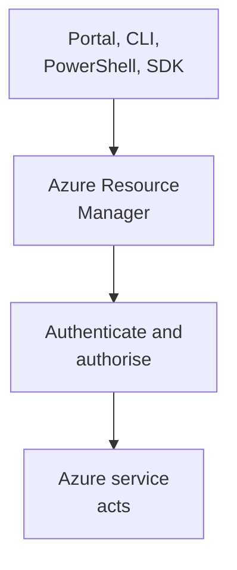
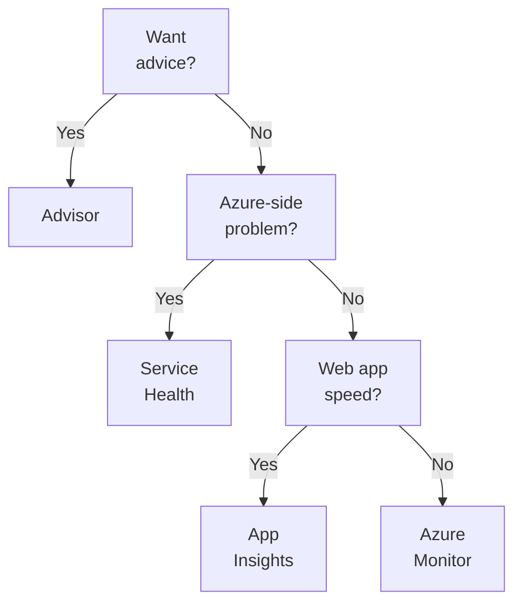

# Domain 3 — Describe Azure management and governance

Describe Azure management and governance is published at 30–35% of the exam. Many of its questions
ask the same thing in different words: which tool does this job? Cost, governance,
deployment and monitoring each have three or four tools that sound alike, and the exam asks you to
pick the one that matches a stated need.

We suggest reading it last, because it leans on the resource hierarchy and identity from Domain 2.

| Exam objective | Where it is taught |
|---|---|
| Describe cost management in Azure | What drives Azure costs; estimating and managing costs; tags |
| Describe features and tools in Azure for governance and compliance | Microsoft Purview, Azure Policy and resource locks |
| Describe features and tools for managing and deploying Azure resources | Tools for managing Azure; Azure Arc; Azure Resource Manager and infrastructure as code |
| Describe monitoring tools in Azure | Advisor, Service Health and Azure Monitor |

The definitions and examples on this page are Microsoft's own, from its exam training and Azure
documentation. The columns headed "the separator", and the monitoring ladder, are our exam guidance.

---

## What this domain actually asks

Three habits carry most of the marks here.

**Estimate before, analyse after.** The pricing calculator estimates what something will cost
before you deploy it. Cost Management shows what you have actually spent, with alerts and budgets.
The Total Cost of Ownership (TCO) calculator has been retired, so it is never the answer.

**Policy shapes resources; locks protect them; RBAC governs people.** Azure Policy controls what
resources may look like. A resource lock stops a resource being deleted or changed. Azure
role-based access control (RBAC), from Domain 2, controls what users may do. They solve different
problems, and you use them together.

**Name the monitoring question.** Recommendations about your resources come from Azure Advisor.
Azure's own outages and maintenance come from Azure Service Health. Your metrics, logs and alerts
come from Azure Monitor. Each question names one of those needs.

---

## What drives Azure costs

**You pay for what you use, so anything that changes what or where you use changes the bill.**
Microsoft lists six factors.

| Factor | What it means | Example |
|---|---|---|
| Resource type | The resource, its settings and its region | Storage type, access speed, copies kept |
| Consumption | Pay-as-you-go, or a discount for commitment | Reservations, savings plan, Spot |
| Maintenance | Keeping only the resources you need | Disks left behind after a VM is deleted |
| Geography | Prices and data transfer vary by location | Power, labour, taxes and fees differ |
| Subscription type | Some subscriptions include allowances | A free trial's credit and free products |
| Azure Marketplace | Third-party solutions bought through Azure | Paying the vendor as well as Azure |

The consumption options are the three Domain 1 compares. A reservation commits to a specific
resource, size and region for a discount, which suits steady use. A savings plan commits to an
hourly spend across eligible services, which suits changing use. Spot uses spare capacity cheaply
and can be evicted, which suits work that tolerates interruption.

Two of these catch people out. **Maintenance**: when you deprovision a virtual machine, the storage
and networking created with it may not go with it, and they keep costing money until you remove
them. **Geography**: the same resource can cost differently in two regions, and moving data
between continents costs more than moving it within one.

Data transfer has its own rule. Some inbound transfer into Azure is free; outbound transfer is
priced by **billing zone**, a geographical grouping of regions used for data-transfer pricing. A
billing zone is not an availability zone.

Azure Marketplace sells Azure-based solutions from third-party vendors, such as a preconfigured
server. You may pay for the vendor's services as well as the Azure services underneath, and the
vendor sets the billing. Microsoft's training says Marketplace solutions are certified and compliant with Azure policies and
standards, under certification policies that vary by solution type. That is the publisher's
certification, not a check against the Azure Policy assignments in your subscription, which still
apply to whatever you deploy.

---

## Estimating and managing costs: the pricing calculator and Cost Management

**The pricing calculator estimates before you deploy; Cost Management analyses after.**

The **pricing calculator** gives an estimated cost for individual resources, a whole solution, or an
example scenario. It covers compute, storage and network costs and options such as storage type,
access tier and redundancy, so you can compare estimates across regions and tiers before you build.
It is for information only: nothing is provisioned, and you are charged for nothing you add.

> **Currency note.** Older courses and question banks ask you to choose between the pricing
> calculator and the Total Cost of Ownership (TCO) calculator. Microsoft's own training now says the
> TCO calculator has been retired, and the current exam guide asks only about the pricing calculator.
> **The exam answer for estimating Azure costs is the pricing calculator.** An option naming the TCO
> calculator is a distractor.

**Microsoft Cost Management** brings together Azure's cost management capabilities: a set of tools to analyse, monitor and manage Azure costs. It
lets you check costs at any time, create alerts on spending, and set budgets. **Cost analysis**
shows your costs visually, by billing cycle, region, resource, subscription, resource group or
service, including accumulated costs against a budget.

A **budget** sets a spending limit for a subscription, resource group, service type or other
scope, with an alert at the threshold you choose. Alerts can be based on actual or forecasted cost.
A budget can also trigger automation, such as shutting down nonproduction resources, but only if you
configure it to.

| Tool | Answers | When | The separator |
|---|---|---|---|
| Pricing calculator | What will this cost? | Before deployment | Nothing is provisioned |
| Cost Management | What have we spent, and where? | After deployment | Actual spend, alerts, budgets |

Microsoft's training names three main types of cost alert:

| Alert | Fires when | For |
|---|---|---|
| Budget alert | Spending reaches a threshold you set | Anyone with a budget |
| Credit alert | Azure Prepayment is being consumed | Enterprise Agreement customers |
| Department spending quota alert | A department reaches a share of its quota | Enterprise Agreement customers |

These are the three to know for the exam, not the whole product. Cost Management can also send
cost anomaly alerts, when daily usage changes unexpectedly, and scheduled alerts, which email the
latest costs from a saved view.

<b>Self-check — estimating and managing costs</b>

1. A team wants a monthly estimate for a planned web app and database before deploying anything.
   Which tool?
2. Does adding a virtual machine to the pricing calculator start billing?
3. Which tool shows where last month's spending went, by resource group?
4. Which alert type warns that spending has reached a limit you set?
5. Why is the TCO calculator never the right answer now?

**Answers.** (1) The pricing calculator. (2) No; nothing is provisioned. (3) Cost Management, through
cost analysis. (4) A budget alert. (5) Microsoft has retired it.

---

## Tags

**Tags are name-value pairs of metadata that you attach to resources.** Alongside subscriptions and
resource groups, they are a way to organise resources. Each tag has a name and a value, such as
`Environment` with `Prod`, and a resource can carry several.

Microsoft lists what tags are used for: resource management, cost management (report costs,
allocate cost centres, track budgets), operations management, security classification, governance
and compliance, and automation. In this domain, **cost reporting** is the use that matters most.

Two rules separate tags from the things they are confused with:

- **Tags are not inherited.** A tag on a resource group or subscription does not appear on the
  resources inside it. You may meet a *tag inheritance* setting in Cost Management: it applies
  parent tags to the cost records of child resources, for reporting, and not to the resources
  themselves.
- **Tags are not access control.** They describe resources; Azure RBAC decides who can act on them.

You manage tags in the portal, PowerShell, the Azure CLI, templates or the REST API. To require a
tag, or put back one that was removed, use Azure Policy. You do not have to put every tag on every
resource.

---

## Governance and compliance: Microsoft Purview, Azure Policy and resource locks

**Purview governs data, Policy governs configuration, and locks guard against deletion and change.**

**Microsoft Purview** is a family of data governance, risk and compliance solutions. It gives one
view of data across on-premises, multicloud and software as a service (SaaS) sources, with
automated data discovery, sensitive data classification and end-to-end data lineage. It has two
solution areas: **risk and compliance**, which works with Microsoft 365 services such as Teams,
OneDrive and Exchange, and **unified data governance**, which covers data in Azure, SQL and Hive
databases, on-premises and other clouds such as Amazon S3. Those are the training's names and the
ones to expect on the exam; the Purview portal now groups its solutions as data governance, data
security and data compliance.

**Azure Policy** creates, assigns and manages policies that control or audit resources, so their
configurations stay compliant with your standards. It highlights noncompliant resources and can
**prevent noncompliant resources from being created**. A policy allowing only certain VM sizes runs
when a VM is created or resized, and it also evaluates VMs that existed before the policy. In some
cases it can fix problems automatically, such as adding a missing required tag. Policies are
**inherited** down the hierarchy, and related policies are grouped into **initiatives**. A compliance
dashboard shows the overall state.

A **resource lock** prevents resources from being accidentally deleted or changed. Locks matter even
with RBAC in place, because people with the right access can still delete something critical by
mistake. Locks apply to a resource, a resource group or a whole subscription, and are inherited by
everything inside. **Locks override RBAC**: even an owner must remove the lock before doing what it
blocks.

Locks protect the resource, not what it holds. They apply only to **control plane** operations, the
management requests that go through Azure Resource Manager. A ReadOnly lock on a database server
stops the server being deleted or modified, but people with access to the data can still create,
update and delete data in its databases.

| Tool | Governs | Typical question | The separator |
|---|---|---|---|
| Microsoft Purview | Data: discovery, classification, lineage | Where is our sensitive data? | Data, not resources |
| Azure Policy | Resource configuration | Allowed regions, sizes, required tags | Shapes resources |
| Resource locks | Deletion and change | Stop anyone deleting this by accident | Protects resources |
| Azure RBAC | What people can do | Who can manage these VMs? | Governs users |

There are two kinds of lock:

| Lock | Read | Modify | Delete |
|---|---|---|---|
| Delete (CanNotDelete on the command line) | Yes | Yes | No |
| ReadOnly | Yes | No | No |

<b>Self-check — governance and compliance</b>

1. A company must restrict new resources to two regions. Which tool?
2. A database must never be deleted by accident, but admins still need to change its settings.
   Which lock?
3. An owner of a resource tries to delete it and fails because of a lock. What must happen first?
4. Which tool finds and classifies sensitive data across on-premises systems and Amazon S3?
5. Does Azure Policy evaluate resources that existed before the policy was assigned?

**Answers.** (1) Azure Policy. (2) A Delete lock. (3) The lock must be removed; locks apply regardless
of RBAC. (4) Microsoft Purview. (5) Yes.

---

## Tools for managing Azure: the portal, Cloud Shell, the Azure CLI and Azure PowerShell

**The portal is graphical; the other three are command-line ways of doing the same work.**

The **Azure portal** is a web-based, unified console. You build, manage and monitor resources with
a graphical interface and can create custom dashboards. It has a presence in every Azure datacenter,
so it survives individual datacenter failures, and it updates continuously with no maintenance
downtime.

**Azure Cloud Shell** is a browser-based shell for managing Azure. It needs no installation, is
already signed in with your Azure credentials, and offers a choice of **Bash or PowerShell**. You
open it from the portal, so it works from any device with a browser.

**Azure PowerShell** runs commands called cmdlets that call Azure's representational state transfer (REST) API. The **Azure command-line
interface (CLI)** is a cross-platform command-line tool for running administrative commands
against Azure. Microsoft describes them as **functionally equivalent**: the main difference is
command syntax, so the choice comes down to which you know. Both can be installed on Windows, Linux
and Mac, and both are available in Cloud Shell. Scripts in either make tasks repeatable.

| Tool | What it is | Runs | The separator |
|---|---|---|---|
| Azure portal | Graphical web console | In a browser | No commands |
| Azure Cloud Shell | Browser-based shell, Bash or PowerShell | In a browser, nothing to install | Already signed in |
| Azure CLI | Cross-platform command-line tool | Locally or in Cloud Shell | Equivalent to PowerShell |
| Azure PowerShell | PowerShell modules running cmdlets | Locally or in Cloud Shell | Equivalent to the CLI |

---

## Azure Arc: managing resources outside Azure

**Azure Arc brings resources outside Azure under Azure management, without moving them.** It works
with Azure Resource Manager to extend Azure's governance, compliance and monitoring to on-premises
and multicloud environments. It does this by projecting non-Azure resources into Azure Resource
Manager, so you can manage them as if they ran in Azure.

Outside Azure, Arc manages servers, Kubernetes clusters, Azure data services and SQL Server. The
point for the exam is the phrase "without migrating": a company that wants one place to govern
servers in its own datacenter and in another cloud uses Arc. Nothing moves to Azure.

---

## Azure Resource Manager, infrastructure as code, ARM templates and Bicep

**Every request to create, update, delete or manage an Azure resource goes through Azure Resource
Manager.** Azure Resource Manager (ARM) is Azure's deployment and management service: the layer that
creates, updates and deletes resources. A request from the portal, PowerShell, the CLI, an API or an SDK reaches ARM, which
authenticates and authorises it, then passes it to the service. Because every tool uses the same
layer, results are consistent.

Microsoft calls these management requests the **control plane**. Using what a resource offers is the
**data plane**, and it does not pass through ARM: you create a storage account through ARM, but
reading and writing the data in it goes to the storage service itself.

ARM also lets you deploy and manage a solution's resources as a group, define dependencies so they
deploy in order, apply access control through built-in RBAC, and apply tags for cost reporting.

**Infrastructure as code (IaC)** means managing infrastructure through code and templates instead of
manual configuration, so the same environment comes out every time. In Azure that ranges from CLI
and PowerShell scripts to templates.

**ARM templates** describe the resources you want in declarative JSON. Declarative means you state
what you want, not the steps to build it: ARM validates the template, works out the order and
creates resources in parallel where it can. Templates give repeatable results across environments.
**Bicep** is a declarative language that does the same job with simpler syntax; each Bicep file is
converted to an ARM template when it deploys.

<b>Self-check — managing and deploying</b>

1. Which layer receives every request to create, update or delete an Azure resource?
2. What makes an ARM template "declarative"?
3. How does Bicep relate to ARM templates?
4. A company wants to apply Azure policies to servers in its own datacenter without migrating them.
   Which service?
5. What is the main difference between the Azure CLI and Azure PowerShell?

**Answers.** (1) Azure Resource Manager. (2) You state what to deploy, not the steps to deploy it.
(3) Bicep is simpler syntax that is converted to an ARM template during deployment. (4) Azure Arc.
(5) Command syntax; they are functionally equivalent.

---

## Monitoring: Advisor, Service Health and Azure Monitor

**Three tools, three questions.** Is there a better way to run my resources? Is Azure itself having
a problem that affects me? What are my resources and apps doing right now?

**Azure Advisor** evaluates your resources and recommends improvements in five categories:
reliability, security, performance, cost and operational excellence. Each recommendation has a
suggested action that you can take, postpone or dismiss, and Advisor can notify you when new
recommendations appear. Its dashboard covers all your subscriptions.

**Azure Service Health** keeps you informed about the health of Azure and your resources through
three views, from broad to narrow:

- **Azure Status**: the health of every Azure service in every region.
- **Service Health**: the services and regions *you* use, with outages, planned maintenance and
  health advisories, and alerts you can set.
- **Resource Health**: one resource, such as a specific VM, and whether a problem is on Azure's side
  or yours.

Service Health keeps historical alerts so you can spot recurring problems, and links you to support
when an event affects your workloads.

**Azure Monitor** collects, analyses and acts on data from your resources and applications, in
Azure, on-premises and in other clouds. It gathers logs and metrics into one place, including Microsoft Entra ID audit logs once you
send them there with diagnostic settings, and exposes them through dashboards, queries and alerts. Three parts of it are named in the guide:

- **Log Analytics**: the portal tool for writing and running queries against Azure Monitor data.
- **Azure Monitor alerts**: these notify you proactively, which helps you detect and address issues
  before users notice them. An alert rule defines a condition, and an action group decides who is
  notified and what happens, including automated workflows.
- **Azure Monitor Application Insights**: performance and usage monitoring for web applications
  anywhere, with request rates, response times, failures and availability tests. You can enable it
  by adding an SDK to the app's code or, where the agent supports your app, with an agent and no
  code changes.

| Tool | Question it answers | Confused with | The separator |
|---|---|---|---|
| Azure Advisor | How can I improve my resources? | Service Health | Recommendations |
| Azure Service Health | Is Azure having problems that affect me? | Azure Monitor | Azure's own events |
| Azure Monitor | What are my resources and apps doing? | Advisor | Your metrics, logs, alerts |
| Application Insights | How is my web app performing? | Log Analytics | App performance |

<b>Self-check — monitoring</b>

1. A team wants to know when Azure plans maintenance in the regions it uses. Which tool?
2. A team wants suggestions to cut costs and improve reliability across its subscriptions. Which tool?
3. In Azure Monitor alerts, what decides who is notified?
4. Which view tells you whether one specific VM's problem is on Azure's side or yours?
5. Which feature detects slow responses and failures in a web app hosted on-premises?

**Answers.** (1) Azure Service Health. (2) Azure Advisor. (3) The action group. (4) Resource Health.
(5) Azure Monitor Application Insights.

---

## Traps worth carrying into the exam

- **The pricing calculator estimates; Cost Management analyses actual spend.** The TCO calculator is
  retired.
- **Nothing is provisioned in the pricing calculator.**
- **Deleting a VM may leave its disks and network resources behind, still costing money.**
- **Costs differ by region; some inbound transfer is free, outbound is priced by billing zone.**
- **Budgets alert at thresholds; automation is optional and yours to configure.**
- **Tags are not inherited and are not access control.** Use Azure Policy to require them.
- **Purview is data governance; Policy is resource configuration; locks stop deletion and change.**
- **Policy can block noncompliant resources and checks existing ones.**
- **A Delete lock still allows changes; ReadOnly does not. Locks beat RBAC, even for owners.** They
  cover control plane operations, not the data inside the resource.
- **The Azure CLI and Azure PowerShell are functionally equivalent.** Cloud Shell runs both in a
  browser, with nothing to install.
- **Azure Arc manages resources outside Azure without moving them.**
- **Every management request goes through Azure Resource Manager. ARM templates and Bicep are
  declarative.**
- **Advisor recommends; Service Health reports Azure's own events; Monitor watches yours.**
- **Resource Health is one resource; Service Health is the services and regions you use.**
- **An alert rule sets the condition; the action group sets who is notified.**
